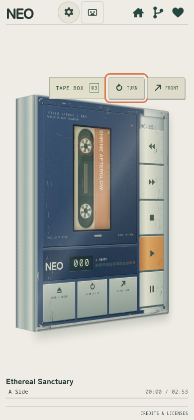
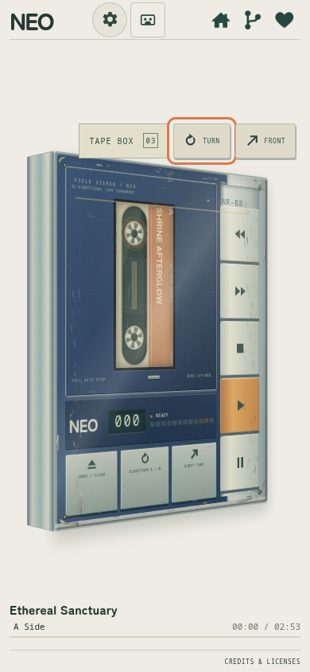
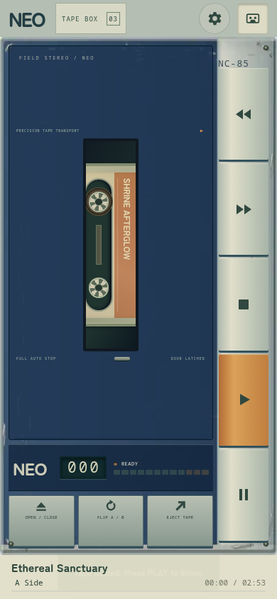
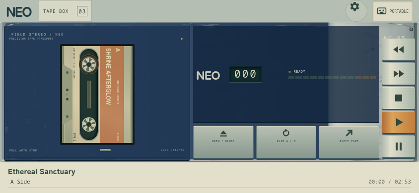

# NEO CASSETTE — NC-85

**A little imperfection. Just right.**

An original, weathered 1980s cassette player for desktop and mobile browsers. No accounts, backend or external music service required. The application is **MIT licensed**; demo music is **creator-supplied**, and mechanical recordings retain **CC0 1.0**.

[Play the demo](https://neo-cassette-tape-player-demo.yomiplush.dev/) · [Creator](https://www.yomiplush.dev/) · [Support](https://github.com/sponsors/yomiplush)


## Features

- Aged paint, scuffed plastic, faded labels and worn screws, made with original SVG textures.
- A dedicated tape collection with three cassettes and six distinct A/B tracks.
- Play, pause, stop, 12x fast forward/rewind, door controls, eject and manual side switching.
- Automatic safe sequences: FLIP stops playback, opens the door, turns a thick 3D-style cassette and closes the door. An already open door stays open. EJECT stops playback and opens the door before removing the tape.
- Animated reels and tape packs, a mechanical-style counter and automatic end stop.
- Tape hiss, wow/flutter, softened highs, saturation and irregular gentle dropouts. Tape character remains at minimum wear.
- Edited CC0 recordings for winding, button presses, stopping and opening/closing the hatch, with a procedural fallback.
- Master volume and tape wear controls. Position is remembered separately for each tape and side. Flipping from the end of either side starts the opposite side at zero.
- Local mixtapes made from your own audio files, stored in IndexedDB without uploading them.
- Keyboard controls, accessible dialogs, reduced-motion support and mobile layouts. Transport and service symbols are original SVG image assets, avoiding platform-dependent emoji rendering.

## Development

Use Node.js 22.12+ or a supported version matching `package.json` (20.19+ is also supported).

```bash
npm ci
npm run dev
```

Open the displayed URL. A phone on the same LAN can use your development computer's LAN address and port.

```bash
npm run build
npm run preview
```

The default build outputs `dist/`. Relative asset paths support subdirectory hosting. Serve the files over HTTP rather than opening them with `file://`.

## Demo and self-hosted editions

Both editions share the same player, audio engine and storage model.

| Edition | Build | Output | Layout |
| --- | --- | --- | --- |
| Demo / Pages | `npm run build` or `npm run build:demo` | `dist/` | Single-viewport player, fitted deck and compact controls |
| Self-hosted | `npm run build:selfhost` | `dist-selfhost/` | Player-focused, fixed mobile transport keys, landscape columns |

The demo fits the deck and essential controls into one viewport, with internally scrolling collection/help dialogs. The self-hosted edition shares the same single-viewport layout, including narrow phones, safe areas, orientation changes and dialogs that fit the viewport. Desktop settings use the available width without an internal sidebar scrollbar. Both editions include the weathered visuals, mechanical sounds and cassette animations.

## Cloudflare Pages

Connect the repository through Pages Git integration with these settings:

| Setting | Value |
| --- | --- |
| Production branch | `main` |
| Framework preset | `None` |
| Build command | `npm run build` |
| Build output directory | `dist` |
| Root directory | Repository root |
| Environment variable | `NODE_VERSION=22` |

See Cloudflare's [build configuration](https://developers.cloudflare.com/pages/configuration/build-configuration/) and [build image documentation](https://developers.cloudflare.com/pages/configuration/build-image/). No API keys, Workers or database are required. Direct Upload of the built `dist/` directory is also supported.

## Self-hosting

With Docker and Compose v2 or later:

```bash
git clone https://github.com/yomiplush/neo-cassette-tape-player.git
cd neo-cassette-tape-player
docker compose up -d --build
```

Open `http://localhost:8080`, or `http://YOUR_SERVER_LAN_ADDRESS:8080` from a phone on the same LAN. Set a different port with `NEO_PORT=8090 docker compose up -d --build`. Stop with `docker compose down`.

The Dockerfile builds the self-hosted edition by default and serves static files through nginx with compression, audio caching and a health check. To update, run `git pull` followed by `docker compose up -d --build`.

Without Docker:

```bash
npm ci
npm run build:selfhost
npm run preview:selfhost -- --port 8080
```

For ongoing hosting, serve `dist-selfhost/` with a static web server. Use `npm run dev:selfhost` during development. HTTPS reverse proxies are supported; importing also works over LAN HTTP without depending on secure-context-only `randomUUID`.

Standalone Docker commands:

```bash
docker build -t neo-cassette .
docker run --rm -p 8080:80 neo-cassette
# Optional demo container:
docker build --build-arg PLAYER_EDITION=demo -t neo-cassette-demo .
```

**Imported music stays in the browser on the current device.** Self-hosting does not add server uploads or synchronization. A different browser, device or origin uses separate storage. The six demos are served locally; normal builds do not download music from external services.


## Controls

1. Open **TAPE BOX** and select **Load this tape**. The deck stops, opens, loads and closes automatically.
2. **▶** plays, **Ⅱ** pauses/resumes and **■** stops without resetting position.
3. **◀◀ / ▶▶** winds continuously at 12x speed until stopped or at the end. Winding plays mechanical sound rather than music.
4. **FLIP A / B** performs the complete safe side-switching sequence. Press play to resume.
5. **EJECT TAPE** stops, opens and removes the cassette. Choose another from TAPE BOX.
6. The mechanical counter follows the tape. NEO and the counter sit below the enlarged cassette pocket; TAPE BOX is in the stationary UI.
7. Choose **Make your own mixtape** to import audio: up to 30 MB and 10 minutes per side. Omitting side B uses side A on both sides. Eject an imported tape before deleting it with **×** in the collection.

Keyboard: `Space` play/pause, `←` rewind, `→` fast forward, `S` stop, `E` door, `F` flip. Shortcuts are suppressed while using forms and dialogs.

## Audio and browser behavior

The first interaction enables Web Audio. This is an expressive simulation of a fictional deck, not a circuit-accurate model of a particular machine. Recording and noise-reduction standards are not implemented.

- Music passes through input gain, a 65 Hz high-pass, tanh saturation, a 3.5–7.3 kHz low-pass, modulated delay, irregular dropouts and a playback envelope.
- Electrical hiss and physical mechanism recordings use separate paths. Recorded winding loops change rate slightly with spool position and fade on stopping. Filtered stochastic noise provides a fallback.
- Slow wow and faster flutter vary with wear. Minimum wear still retains filtering, noise and modulation.
- Decoded audio is cached for up to two recordings with an 80 MiB budget. A single playing file must still be fully decoded, so longer files use more temporary memory.
- Switching tabs preserves playback and pending play requests. The transport uses the audio clock, and natural audio completion stops the tape effects even if UI timers are throttled. Closing or navigating away from the page stops playback. Screen-lock/background behavior can still be restricted by the browser or OS. STOP cancels pending loads; network loads time out after 25 seconds.
- Supported formats depend on the browser's decoder. MP3, WAV and M4A are typical choices; OGG support varies.
- Browser storage cleanup can delete imported audio. Keep your original files.

## Music and licenses

Application source: [MIT](LICENSE). Current demo music consists of six creator-supplied recordings, with **MobileAmbience** retained from their artist metadata. Music is separate from the code license; it is not designated CC0 or relicensed under MIT. See [the music notice](public/licenses/DEMO-MUSIC.txt) before reusing these recordings.

| Tape | Original folder | Side A | Side B |
| --- | --- | --- | --- |
| SHRINE AFTERGLOW | Shrine Mix | Ethereal Sanctuary | Ethereal Sanctuary / Take 2 |
| PILLOW RADIO | Cozy Mix | Lost Inari | Our Squishy Dreams |
| MIDNIGHT CIRCUIT | Cool Mix | Corner Booth | Infosec |

Each folder supplies one cassette with two complete tracks. English display labels are used in the player; original filenames and embedded source titles remain in `public/audio/manifest.json`, together with exact durations and input/output SHA-256 hashes. The supplied files have .mp3 names but contain M4A streams, so browser copies are encoded as actual 128 kbps MP3. Source files are never modified. No cassette effects are baked in; those remain part of playback.

To prepare playback copies from the same folder structure, install Python and ffmpeg:

```bash
python scripts/prepare-audio.py '/path/to/my vibes'
```

The previous CC0 demo source and license are retained under `vendor/duru-ai/` as historical attribution; its recordings are no longer served.

Mechanical recordings are by stecman, Joseph SARDIN / BigSoundBank and Spring Spring, all CC0. Source links and edits are in `public/sfx/credits.json`, license text in `public/licenses/SFX-CC0.txt`, and measurements/design rationale in [the sound research notes](docs/research/cassette-sound.md). No YouTube audio is redistributed.

Reference photographs, manufacturer logos and product images are not included. No external fonts, CDN or analytics are used. Dependency notices are in [THIRD_PARTY_NOTICES.md](THIRD_PARTY_NOTICES.md).

## Social previews and generated assets

The demo's initial HTML contains Open Graph metadata and a Twitter large-image card. The 1200×630 cover at `public/social/neo-cassette.png` is rendered from the actual UI by `scripts/social-preview.mjs`. X and Discord control their own preview caches.

For self-hosted social previews, build with your public URL:

```bash
VITE_SITE_URL=https://your.example npm run build:selfhost
```

Without this setting, self-hosted builds do not publish the demo's canonical URL.

The top-right generated image icons link to home, source and sponsorship in that order. Originals and exact prompts are preserved in [vendor/generated-icons](vendor/generated-icons/README.md).

## Verification

```bash
npm test
npx playwright install chromium
npm run test:browser
npm run test:selfhost
npm run build:demo
npm run build:selfhost
```

Checks cover transport boundaries, saved positions, actual Web Audio rendering, recorded sound decoding/retries, imports and deletion, six demo decodes, cancellation, cassette animations, reduced motion, responsive layouts and initial-HTML social metadata. Browser automation uses Chromium. Listening tests and OS interruption behavior on physical iOS/Android devices require separate verification.

A GitHub Actions example is provided at `docs/ci-check.example.yml`. Copy it to `.github/workflows/check.yml` to enable it; it is not installed as an active workflow.

## Source layout

- `src/transport.js`: DOM-independent cassette transport.
- `src/flip.js`: cassette geometry, flip/eject animations and cleanup.
- `src/audio.js`, `src/mechanisms.js`: Web Audio, caching, tape effects and mechanical recordings.
- `src/library.js`: demo definitions, settings and IndexedDB.
- `src/main.js`, `src/style.css`: interface, controls, lifecycle and responsive styling.
- `src/assets/`: original weathering textures and generated navigation icons.
- `compose.yml`, `deploy/nginx.conf`: self-hosted static serving.
- `public/audio/`, `public/sfx/`: audio, credits and integrity manifests.

## Turn the deck, change the finish

Drag the case or its turn handle to inspect its sides, headphone sockets, volume wheel, belt clip and battery cover. The front, back and four edges are real browser-native CSS 3D surfaces; the existing front controls remain native buttons. **FRONT** returns to the operating view. On the turn handle, arrow keys rotate and `Home` restores the front. A drag does not also press the window latch. FLIP/EJECT return the case to the front before servicing the tape.

Five original finishes are included: **Harbor Blue, Silver Line, Midnight Graphite, Signal Red and Ivory Studio**. Each includes original paint wear and exposed-metal patches. No manufacturer logos, reference photos or copied product skins are distributed.

On phones/tablets up to 1024px in portrait, the image gear button lowers a fabric-like settings curtain. **BACK TO THE DECK** or Escape lifts it away. Rotation to landscape restores the same settings controls to the liner. The controls are moved rather than duplicated, values persist, playback continues, and reduced-motion preferences are respected. Horizontal/desktop layouts retain inline settings.

**TAPE CHARACTER** adds optional Light / Home dub, Medium / Street copy and Heavy / Attic find profiles based on tone targets from the creator's [MIT cassette filter](https://github.com/yomiplush/youtube-cassette-filter). The original Archive profile remains the default. These are coloration choices, not measured hardware emulations. The current engine retains its own subtle modulation and separate CC0 mechanics; no audio samples were found or copied from the old project. Pinned sources and measurements: [legacy filter research](docs/research/legacy-filter.md). Original MIT notice: `vendor/youtube-cassette-filter/LICENSE`.

  

Regenerate these previews against the development server with `node scripts/screenshots-case.mjs`.

## Manual or auto-reverse hardware

**DECK** selects the original **NC-85 / Manual flip** or **NR-88 / Auto reverse**. The NR-88 has its own trim, model markings, head carriage and slightly different case depth. It switches track direction without opening the door or physically flipping the cassette. Playback continuously alternates A→B→A (or B→A→B), starting each side at zero, until STOP. Winding never triggers automatic reversal. STOP cancels a pending reversal. Changing hardware stops playback and cancels pending loads.

The NR-88's **DIRECTION A / B** control follows the physical tape position when switching direction midway; automatic end reversal starts the opposite side at zero. Tape-pack graphics retain their physical orientation on B. The NC-85 keeps the existing manual FLIP and independent saved side positions.

## Adaptive rendering

The case now has a thicker six-face shell and a stationary **TURN / FRONT** toolbar. TURN advances by 90 degrees; dragging and keyboard rotation remain available. The old flat top/bottom decorations have been removed, so they cannot float outside the rotating case.

**DISPLAY** defaults to **Auto**. It uses optional device hints and measured visible animation-frame intervals, with hysteresis, to choose:

| Tier | Drag pose update budget | Material texture dimensions | Active UI interval |
| --- | --- | --- | --- |
| Economy | Up to 30 fps | 50% | 120 ms |
| Balanced | Up to 60 fps | 75% | 80 ms |
| Full | Up to 60 fps | Original SVG detail | 50 ms |

These are update budgets rather than guaranteed display frame rates. CSS compositor transitions are left to the browser. Hidden/back-facing surfaces are culled; CSS backface culling handles the interpolated pose while turning. The visible-frame monitor sleeps when idle or hidden. Transport timing continues to use the AudioContext clock and is independent of visual updates.

This is a DOM/CSS 3D renderer, so **AMD FSR is not used**. Only the original weathering/material artwork is rasterized at lower tiers; text, buttons and model geometry retain native resolution. A fixed studio-light highlight moves over the brushed-metal case as it rotates. Balanced uses a simpler highlight; Economy removes it and reduces shadows and texture layers. Sustained intervals below 30 fps trigger a reduction after two seconds; sustained headroom restores detail one tier at a time after twelve seconds. Manual Economy/Balanced/Full overrides persist. Automatic hardware detection is a hint and cannot identify every low-end device, so the manual override remains available.

Regenerate the lightweight material assets from the original SVGs with `node scripts/prepare-materials.mjs` against the development server. The outputs are checked in; normal builds do not need a browser rasterization step. Reference and design notes: [case and reverse notes](docs/research/case-quality-auto-reverse.md).

 


The cassette keeps its 1.62:1 shell proportions and is installed vertically, with a matching portrait viewing aperture. Manual FLIP and EJECT first lift the tape behind the glass, then bring it forward only after its lower edge clears the window. FLIP turns the tape in front of the deck, moves it back above the window, and lowers it behind the glass. Reduced motion changes the side immediately; resizing or cancelling the operation cleans up the temporary model. Auto-reverse changes direction internally without extracting the tape.


The 3D enclosure uses fixed 400 × 500 logical geometry on every screen. Window size changes apply one uniform scene scale; the shell, window, controls and side depth never stretch or rearrange. The stationary TURN / FRONT toolbar keeps its native size. Very short landscape screens scale the physical buttons with the model (at least 24 CSS px in the tested phone sizes); normal portrait controls retain 44 px targets. Compact portrait layouts omit the optional liner strip to preserve the enclosure and controls.


The current enclosure is an original NEO field stereo, with a navy front, a narrow smoked reel window, a brushed-metal transport spine, and five vertical mechanical keys. It includes no headphones or real manufacturer branding. Other NEO finishes and the two transport models remain selectable. A temporary opaque door surface masks the cassette outside the narrow aperture while it is lifted or seated; it moves in front only after fully clearing the door's upper lip.


## Portable 2D mode and mechanical keys

On phones and tablets up to 1024 CSS px wide, the cassette-image **PORTABLE** switch in the header changes the same player into a flat, screen-sized 2D panel. The mode preference is saved. Returning to a larger desktop screen restores the 3D presentation; returning to a supported device restores the preferred portable presentation. Switching does not stop audio, change sides, lose position, or recreate the audio engine.

The original shell material is baked into five small WebP images (about 14 KB combined). The live buttons, counter, cassette and audio remain interactive. Portable mode hides all side/back geometry and reflections, removes perspective, suspends the adaptive renderer's animation-frame monitor, and updates its lightweight UI/reel pose every 160 ms while active. It uses a short, flat side change instead of the 3D extraction animation. Settings remain available behind the curtain in either device orientation. Manual and auto-reverse transport behavior is preserved.

In 3D mode, dragging either the model or the blank room background rotates it. Buttons, links, sliders, the liner and dialogs retain their own interactions. Portable mode ignores rotation gestures.

PLAY, REW and F.FWD keys latch visibly into the enclosure. Selecting another transport releases the previous key; PAUSE retains PLAY and latches the pause key, and STOP or the end of manual playback releases them; auto-reverse keeps PLAY latched through its direction change. Accessible `aria-pressed` states follow the same mechanism. The same latching feel is rendered as a cheap 2D inset in portable mode.

To regenerate the material images from the original code-native enclosure, run the development server and `node scripts/prepare-portable.mjs`. Normal builds use the checked-in images and do not require ffmpeg or a screenshot pass.

 

Portable mode follows **FINISH** immediately, after reload and when switching back from 3D. Both the bitmap shell and door/readout materials use the selected finish. Track title, A / B Side and elapsed / total time stay in a stationary summary, including while viewing the back and in the flat portable panel. The collection button stays outside the enclosure; RESET has been removed.
